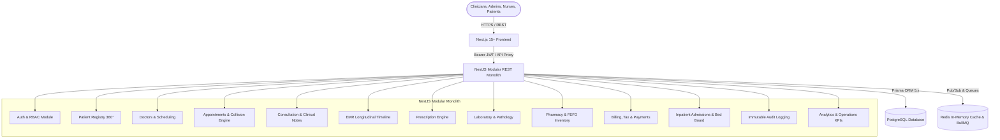
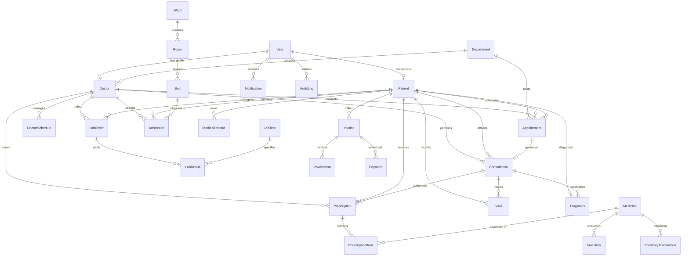

# Hospital Management & Integrated Healthcare System (HMIS)

An enterprise-grade, full-stack Hospital Management & Integrated Healthcare System (HMIS) engineered with a **Modular Monolith** architecture. Designed for clinical reliability, strict role-based access control (RBAC), high-throughput transactional integrity, and a healthcare SaaS user experience.

---

## 🏛️ System Architecture



---

## 💻 Tech Stack

### Frontend
- **Framework**: Next.js 15+ (App Router, Server & Client Components)
- **Language**: TypeScript
- **Styling**: Tailwind CSS with custom medical design tokens
- **Data Visualization**: Recharts (Financial Area Trends, Department Workloads, Bed Census Donut)
- **Icons**: Lucide React
- **Forms & Validation**: React Hook Form + Zod
- **Networking**: Custom standard API client with automatic JWT token management

### Backend
- **Framework**: NestJS 10 (Modular Monolith)
- **Runtime**: Node.js v20+ / TypeScript
- **Database & ORM**: PostgreSQL 16 + Prisma ORM
- **Authentication**: Passport-JWT, bcrypt password hashing, refresh tokens, audit tracking
- **API Documentation**: OpenAPI / Swagger UI at `/api/docs`
- **Security**: Helmet, Rate Limiting, Centralized Exception Filters, Transform Interceptors
- **Caching & Async**: Redis 7, BullMQ queue architecture

---

## 👥 Role-Based Access Control (RBAC) & Demo Credentials

The platform includes seed data with pre-configured accounts for all healthcare roles. A 1-click **Persona Switcher** is built into both the `/login` page and the top navigation bar.

| Role | Email | Password | Primary Scope |
|---|---|---|---|
| **Super Admin** | `admin@hmis.local` | `Admin@123456` | Full system governance, audit trail, user role administration |
| **Cardiologist** | `doctor.carter@hmis.local` | `Password@123` | Patient queue, vitals intake, diagnoses, prescriptions |
| **Staff Nurse** | `nurse.sarah@hmis.local` | `Password@123` | Inpatient bed census, patient triage, clinical vitals |
| **Receptionist** | `receptionist@hmis.local` | `Password@123` | Front-desk intake, appointment booking, patient registration |
| **Pharmacist** | `pharmacist@hmis.local` | `Password@123` | Prescription dispensing (FEFO), stock alerts, batch restock |
| **Lab Technician** | `labtech@hmis.local` | `Password@123` | Specimen intake, test processing, verified lab reporting |
| **Accountant** | `accountant@hmis.local` | `Password@123` | Invoicing, payment settlement, tax breakdown |
| **Patient** | `patient.james@hmis.local` | `Password@123` | Patient portal, personal medical timeline, prescription view |

---

## 🗄️ Relational Database Architecture



---

## 🚀 Quickstart & Local Setup

### Prerequisites
- Node.js v20+
- npm v10+
- Docker & Docker Compose

### 1. Clone Repository & Setup Environment
```bash
git clone https://github.com/your-username/hmis.git
cd hmis

# Copy sample environment
cp .env.example .env
cp .env.example backend/.env
```

### 2. Start PostgreSQL & Redis Containers
```bash
docker compose up -d postgres redis
```
- PostgreSQL runs on `localhost:5434`
- Redis runs on `localhost:6379`

### 3. Setup Backend & Seed Database
```bash
cd backend
npm install
npx prisma generate
npx prisma db push
npm run prisma:seed
npm run build
npm run start:prod # or npm run start:dev
```
- API server listens on: `http://localhost:4000/api/v1`
- Swagger UI Interactive Docs: `http://localhost:4000/api/docs`

### 4. Setup Frontend
```bash
cd ../frontend
npm install
npm run build
npm run start # or npm run dev
```
- Web Application accessible at: `http://localhost:3000`

---

## 🐳 Full Containerized Deployment (Docker Compose)

To launch the entire platform in Docker containers:
```bash
docker compose up -d --build
```
This boots all four interconnected services:
1. `hmis_postgres`: PostgreSQL 16 Alpine database
2. `hmis_redis`: Redis 7 Alpine in-memory cache & queue
3. `hmis_backend`: NestJS production container on port 4000
4. `hmis_frontend`: Next.js 15 production container on port 3000

---

## 🧪 Testing

```bash
# Run backend unit tests (Appointments, Double-Booking, Billing calculations)
cd backend
npm test

# Run test coverage
npm run test:cov
```

---

## 🛡️ Security & Healthcare Privacy Considerations

- **Password Hashing**: Bcrypt with 10 salt rounds
- **Session Tokens**: Short-lived Bearer JWT access tokens paired with cryptographically hashed refresh tokens in the database
- **Security Headers**: Helmet configured for secure frame guards and strict transport security
- **Data Sanitization**: Global ValidationPipe enforcing DTO class-validator stripping and whitelist validation
- **Fine-Grained Permissions**: RBAC guards checking `@RequirePermissions()` and `@Roles()` on every route
- **Immutable Audit Ledger**: All sensitive patient data views, prescription creations, dispensing, and admissions are written to the database `AuditLog` table with IP and timestamp metadata
- **Notice**: Built with synthetic patient demonstration data for academic and engineering showcase purposes. Legal HIPAA compliance requires formal BAA agreements and audited infrastructure certification before handling real PHI.
